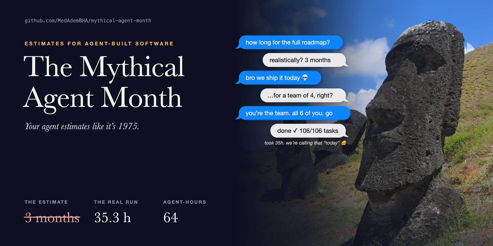

# 🗿 Mythical Agent Month

<p align="center"></p>

**Your agent said 5 months. Agents built it in 35 hours.**

An estimation skill for Claude Code, Codex, Cursor, Gemini CLI and Copilot (plus a paste-in prompt for anything else) that stops AI from quoting human-team timelines for agent-built software.

> Brooks, 1975: *"Adding manpower to a late software project makes it later."*
> 2026: your agent still estimates like it's 1975.

---

## The problem

Ask an AI "how long will this roadmap take?" and you get "3-5 months", sprint plans, story points. That's human-team pace, learned from human tickets.

We ran the real thing: a **106-task, 7-repo SaaS roadmap** built by autonomous agents (worktrees, parallel lanes, tests first, reviewer agents, phase-end suites).

| | Naive AI estimate | Real run |
|---|---|---|
| Time | "about 5 months" (60-100 days) | **35.3 h** agent wall-clock |
| Agent-hours | - | 64.2 |
| Usage | - | ~35-40% of a weekly limit |
| Ready to merge | - | ~3 days |

The code wasn't the slow part. Tests, review, decisions and the usage limit were.

### How accurate is the skill? Honestly:

| Test | Raw "likely" wall-clock | **Plan** (likely × 1.3, the bold number it prints) |
|---|---|---|
| In-sample fit: defaults measured on this run, run on its own task graph | 31.1 h vs 35.3 h real (-12%) | **40 h (+14%)** |
| **Held-out:** fit on phases 0-3, predict phases 4-9 blind | 12.4 h vs 19.8 h real (-37%) | **16 h (-19%)** |

So it gets the **order of magnitude** right: hours, not months. The raw model **leans optimistic**, so until you calibrate, the number it prints in bold is the **plan** (likely × 1.3), with the likely value and the range beside it. It's still **n = 1**: one project, one laptop, one setup. The method is in [`examples/holdout.md`](examples/holdout.md). **A second, independent run is the missing evidence. Yours would help.**

## What it does

It never gives one big number. It separates:

- **Machine time**: agent wall-clock and agent-hours, using the task graph's **critical path** and the parallelism you really get.
- **Human effort**: prompting, review per commit, local setup, click-through.
- **Waiting**: decisions and usage-limit resets. They're calendar time, never effort.
- **Usage**: the % of your weekly limit, so you know whether the run fits this week.

There are two modes:

| Mode | When | Output |
|------|------|--------|
| **A: Developer + AI** | You drive an assistant task by task | Focus hours and days, with a calendar range |
| **B: Autonomous agents** | A plan split into tasks that agents build, often in parallel | Wall-clock, agent-hours, critical path, usage %, calendar to ready-to-merge |

Both modes show the no-AI pace as a **comparison line only**.

## Numbers from real runs, not vibes

The defaults are measured on **398 subagent runs from one real build**, not hand-tuned:

| Agent kind | Median | p75 |
|---|---|---|
| Code task, high risk (big model) | 30 min | 39 min |
| Code task, normal risk | 11 min | 24 min |
| Code task, low risk (small model) | 3.5 min | 8 min |
| Reviewer agent | 8 min | 12 min |
| Merge | <1 min | <1 min |

Lessons from that run that ended up in the model:

- **Effective parallelism ≈ 0.3 × your agent cap.** 6 agents gave about 1.8 agents of throughput once test slots, file conflicts and merge locks queued, and it fell to 1.4 late in the run.
- **Risk dominates size.** High-risk tasks (billing, auth, migrations) took 2.7× a normal one; size by file count barely mattered. High risk is also where every real bug was caught.
- **The failure tax is real: +15-25%** for retries, fix-up agents, broken gates and full disks.
- **The human tail is small in hours but sets the calendar:** decisions, migrations, local setup.

The full case study, with the incidents and what each one cost, is in [`references/real-runs.md`](skills/mythical-agent-month/references/real-runs.md).

## Install

**Claude Code plugin** (Claude Code 2.1.275 or later):

```
/plugin install mythical-agent-month --marketplace MedAdemBHA/mythical-agent-month
```

It also works with **any agent that supports the open [Agent Skills](https://agentskills.io) standard** (`SKILL.md`). One line:

```bash
curl -fsSL https://raw.githubusercontent.com/MedAdemBHA/mythical-agent-month/main/install.sh | bash -s -- all
```

Prefer not to pipe to bash? It only copies one folder, so do it by hand:

```bash
git clone --depth 1 https://github.com/MedAdemBHA/mythical-agent-month.git
cp -R mythical-agent-month/skills/mythical-agent-month ~/.claude/skills/   # or your agent's folder below
```

Or choose your agents, and add `--project` to install into the current repo instead of your home folder:

```bash
./install.sh claude codex --project
```

| Agent | Personal folder | Project folder |
|---|---|---|
| Claude Code | `~/.claude/skills/` | `.claude/skills/` |
| OpenAI Codex | `~/.agents/skills/` | `.agents/skills/` |
| Cursor | `~/.cursor/skills/` | `.cursor/skills/` |
| Gemini CLI | `~/.gemini/skills/` | `.gemini/skills/` |
| GitHub Copilot (VS Code) | `~/.copilot/skills/` | `.github/skills/` |
| claude.ai | upload `mythical-agent-month.skill` from [Releases](../../releases) in Settings → Capabilities → Skills | |
| Anything else (ChatGPT, Windsurf, custom agents) | paste [`portable-prompt.md`](skills/mythical-agent-month/assets/portable-prompt.md) into rules or the system prompt | |

Any other tool that reads `SKILL.md`: copy `skills/mythical-agent-month/` into its skills folder. The scripts need only Python 3.

Then just ask: *"how long will this take?"*, *"estimate this backlog"*, *"how long will this workflow run?"*, or paste an estimate to check.

## Try it

```bash
cd skills/mythical-agent-month
python3 scripts/totals.py ../../examples/agent-feature.json       # 8-task feature, agents
python3 scripts/totals.py ../../examples/dev-feature.json         # same feature, developer + AI
python3 scripts/totals.py ../../examples/roadmap-106-tasks.json   # the real 106-task run (anonymised)
```

You only need Python 3, with no dependencies. The output is Markdown; add `--json` for totals only. Sample outputs are in [`examples/`](examples/).

Mode B input, minimal:

```json
{
  "mode": "agent",
  "machine": {"parallel_agents": 6, "effective_parallelism": 1.8},
  "items": [
    {"id": "t1", "task": "Schema + migration", "size": "M", "risk": "high", "depends_on": []},
    {"id": "t2", "task": "API", "size": "L", "risk": "high", "depends_on": ["t1"]},
    {"id": "t3", "task": "UI", "size": "M", "risk": "normal", "depends_on": ["t2"]}
  ]
}
```

## Does the skill actually change answers?

[`examples/with-vs-without.md`](examples/with-vs-without.md) has one everyday prompt answered with and without the skill by Claude Code's own eval runner, both copied verbatim. Without the skill, Claude already calls a 6-week estimate too long. The skill's difference is structure: decision waits kept separate from effort, a calendar range, questions to unblock first, and per-task risk.

[`evals/`](evals/) holds 6 cases you can run yourself, including one where the skill must **not** apply (a team working without AI):

```bash
claude plugin eval . --runs 3      # with vs without the skill, scored by an LLM judge
```

## Calibrate with your own runs

My numbers come from my machine and my codebase, so yours will differ. Point the calibrator at your Claude Code subagent transcripts:

```bash
python3 scripts/calibrate.py ~/.claude/projects/<project>/<session>/subagents --tasks tasks.json
```

It's read-only: it uses timestamps, labels, model names and token counts, and prints no content. You get:

- real minutes per agent kind, risk and size;
- your effective parallelism;
- your retry rate;
- the exact knobs to change.

**Please share your numbers.** Open an issue or PR adding your run to `real-runs.md`. More runs make better defaults for everyone.

## Repo layout

```
skills/mythical-agent-month/
  SKILL.md                  the skill: modes, steps, output format
  references/heuristics.md  tables for both modes + the reasoning
  references/real-runs.md   measured reference cases (add yours)
  references/calibration.md log formats and what to tune
  scripts/totals.py         the math: PERT, critical path, parallelism, usage
  scripts/calibrate.py      read your agent transcripts, get your own numbers
  assets/portable-prompt.md paste-in version for any assistant
examples/                   inputs, generated outputs, held-out test, with vs without
evals/                      6 eval cases for `claude plugin eval`
.claude-plugin/             plugin + marketplace manifests
install.sh                  installer for every supported agent
assets/hero.html            source of the banner (render: headless Chrome, 1280x640 @3x)
```

## Credits

The name is a nod to Fred Brooks' *The Mythical Man-Month* (1975). Banner photo: ["Moai Rano raraku"](https://commons.wikimedia.org/wiki/File:Moai_Rano_raraku.jpg) by Aurbina, Wikimedia Commons, public domain. Mode A builds on an earlier developer-plus-AI estimate skill. The case study comes from a real autonomous build in 2026, anonymised.

## License

MIT
