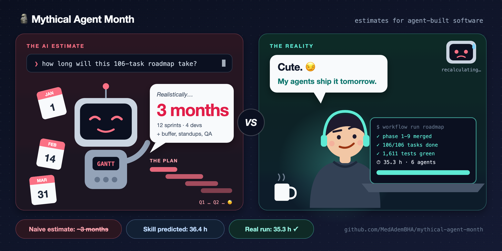

# 🗿 Mythical Agent Month

<p align="center"></p>

**Your agent said 5 months. Agents built it in 35 hours.**

An estimation skill for Claude Code (and a paste-in prompt for any other assistant) that stops AI from quoting human-team timelines for agent-built software.

> Brooks, 1975: *"Adding manpower to a late software project makes it later."*
> 2026: your agent still estimates like it's 1975.

---

## The problem

Ask an AI "how long will this roadmap take?" and you get "3-5 months", sprint plans, story points. That's human-team pace, learned from human tickets.

We ran the real thing: a **106-task, 7-repo SaaS roadmap** built by autonomous agents (worktrees, parallel lanes, tests first, reviewer agents, phase-end suites).

| | Naive AI estimate | Mythical Agent Month | Real run |
|---|---|---|---|
| Time | "about 5 months" (60-100 days) | **36.4 h** agent wall-clock | **35.3 h** |
| Agent-hours | - | 65.5 | 64.2 |
| Usage | - | ~39% of a weekly limit | ~35-40% |
| Ready to merge | - | 3-6 calendar days | ~3 days |

The code wasn't the slow part. Tests, review, decisions and the usage limit were.

## What it does

It never gives one big number. It separates:

- **Machine time**: agent wall-clock and agent-hours, using the task graph's **critical path** and the parallelism you really get.
- **Human effort**: prompting, review per commit, local setup, click-through.
- **Waiting**: decisions and usage-limit resets. They're calendar time, never effort.
- **Usage**: the % of your weekly limit, so you know whether the run fits this week.

There are two modes:

| Mode | When | Output |
|------|------|--------|
| **A: Developer + AI** | You drive an assistant task by task | Focus hours and days, with a calendar range |
| **B: Autonomous agents** | A plan split into tasks that agents build, often in parallel | Wall-clock, agent-hours, critical path, usage %, calendar to ready-to-merge |

Both modes show the no-AI pace as a **comparison line only**.

## Numbers from real runs, not vibes

The defaults are measured on **398 real subagent runs**:

| Agent kind | Median | p75 |
|---|---|---|
| Code task, high risk (big model) | 30 min | 39 min |
| Code task, normal risk | 11 min | 24 min |
| Code task, low risk (small model) | 3.5 min | 8 min |
| Reviewer agent | 8 min | 12 min |
| Merge | <1 min | <1 min |

Lessons from that run that ended up in the model:

- **Effective parallelism ≈ 0.3 × your agent cap.** 6 agents gave about 1.8 agents of throughput once test slots, file conflicts and merge locks queued.
- **Risk dominates size.** High-risk tasks (billing, auth, migrations) took about 2.7× a normal one. That's also where every real bug was caught.
- **The failure tax is real: +15-25%** for retries, fix-up agents, broken gates and full disks.
- **The human tail is small in hours but sets the calendar:** decisions, migrations, local setup.

The full case study, with the incidents and what each one cost, is in [`references/real-runs.md`](skills/mythical-agent-month/references/real-runs.md).

## Install

**Claude Code** (personal skill, all projects):

```bash
git clone https://github.com/MedAdemBHA/mythical-agent-month.git
mkdir -p ~/.claude/skills
cp -r mythical-agent-month/skills/mythical-agent-month ~/.claude/skills/
```

Per project: copy it into `.claude/skills/` instead. Claude picks it up when you ask "how long will this take?", "estimate this backlog", "how long will this workflow run?", or paste an estimate to check.

**claude.ai:** upload `mythical-agent-month.skill` from [Releases](../../releases) under Settings → Capabilities → Skills.

**Any other assistant** (ChatGPT, Gemini, Cursor rules): paste [`assets/portable-prompt.md`](skills/mythical-agent-month/assets/portable-prompt.md).

## Try it

```bash
cd skills/mythical-agent-month
python3 scripts/totals.py ../../examples/agent-feature.json       # 8-task feature, agents
python3 scripts/totals.py ../../examples/dev-feature.json         # same feature, developer + AI
python3 scripts/totals.py ../../examples/roadmap-106-tasks.json   # the real 106-task run (anonymised)
```

You only need Python 3, with no dependencies. The output is Markdown; add `--json` for totals only. Sample outputs are in [`examples/`](examples/).

Mode B input, minimal:

```json
{
  "mode": "agent",
  "machine": {"parallel_agents": 6, "effective_parallelism": 1.8},
  "items": [
    {"id": "t1", "task": "Schema + migration", "size": "M", "risk": "high", "depends_on": []},
    {"id": "t2", "task": "API", "size": "L", "risk": "high", "depends_on": ["t1"]},
    {"id": "t3", "task": "UI", "size": "M", "risk": "normal", "depends_on": ["t2"]}
  ]
}
```

## Calibrate with your own runs

My numbers come from my machine and my codebase, so yours will differ. Point the calibrator at your Claude Code subagent transcripts:

```bash
python3 scripts/calibrate.py ~/.claude/projects/<project>/<session>/subagents --tasks tasks.json
```

It's read-only: it uses timestamps, labels, model names and token counts, and prints no content. You get:

- real minutes per agent kind, risk and size;
- your effective parallelism;
- your retry rate;
- the exact knobs to change.

**Please share your numbers.** Open an issue or PR adding your run to `real-runs.md`. More runs make better defaults for everyone.

## Repo layout

```
skills/mythical-agent-month/
  SKILL.md                  the skill: modes, steps, output format
  references/heuristics.md  tables for both modes + the reasoning
  references/real-runs.md   measured reference cases (add yours)
  references/calibration.md log formats and what to tune
  scripts/totals.py         the math: PERT, critical path, parallelism, usage
  scripts/calibrate.py      read your agent transcripts, get your own numbers
  assets/portable-prompt.md paste-in version for any assistant
examples/                   inputs + generated outputs
assets/hero.html            source of the banner (render: headless Chrome, 1280x640 @2x)
```

## Credits

The name is a nod to Fred Brooks' *The Mythical Man-Month* (1975). Mode A builds on an earlier developer-plus-AI estimate skill. The case study comes from a real autonomous build in 2026, anonymised.

## License

MIT
